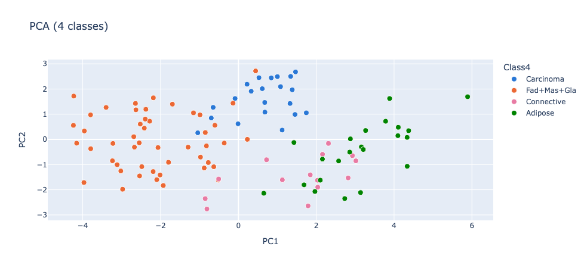
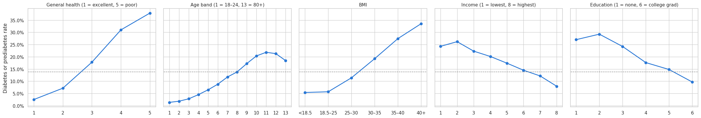
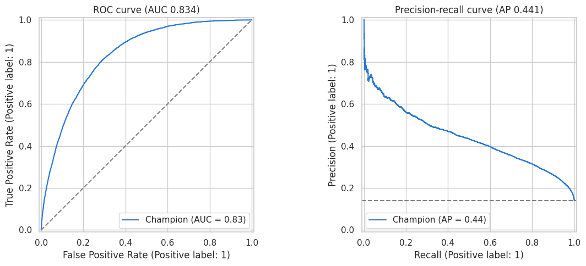
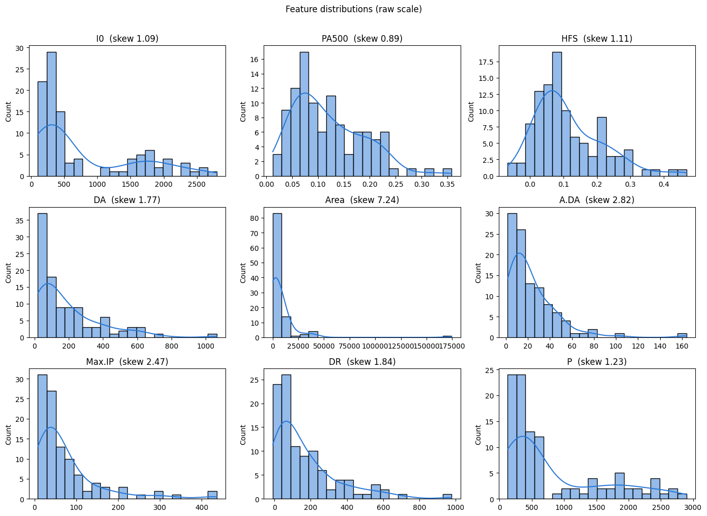
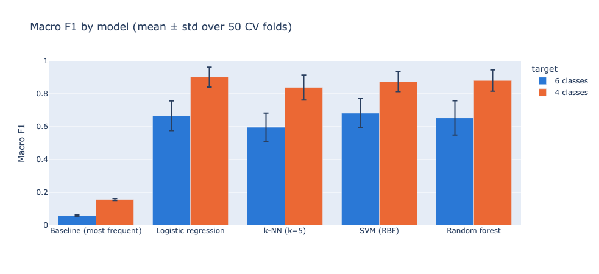

# Introduction

This repo includes two comprehensive notebooks that that shows how to do exploratory data analysis (EDA) and machine learning on Databricks. You should be able to run this notebook on the Databricks free edition.

# Diabetes Notebook

- We used Spark to process the larger data volume
- We created a baseline model across 253K records and registered that baseline model with Unity Catalog. 
- The baseline was given the alias of `Champion` which allows code to use the best model registered at a given time. 
- We logged experiments to find a better model using ML Flow. 
- Optuna was used to experiment across hyper parameters to find a better configuration. 
- Once we identified a better model we moved the `Champion` alias to point and the best model.
- We tested the new champion to confirm its performance

This workflow models more of way teams work in practice where a new model is only used when it is proven to work better than the best model to date.

# Breast Cancer Notebook

The notebook uses a small breast cancer dataset suitable for classification and is meant for single node or serverless deployments so it uses Pandas over Spark. The Spark approach is best for very large datasets that are difficult to fit on a single node.

## Exploratory Data Analysis

Topics covered include:

- Install additional visualization libraries
- Load CSV data from a file
- Display data
- Access data attributes
   - Row and column counts
   - Data types
   - Column names
   - Descriptive statistics
- Data clean up
   - Add new columns
   - Drop duplicate data
   - Transform for skew
- Data quality
   - Missing data, zeros, negatives, and duplicates
   - Visualize class distribution
   - Visualize data skew
   - Check for outliers
   - Visualize feature distribution by class
   - Feature separation
   - Visualize relationships between features
   - Principal component analysis

## Machine Learning

- Classification models
    - Logistic regression
    - K Nearest Neighbor
    - Support Vector Machine
    - Random Forrest Classifier
- Compare models
- Confusion matrix (error matrix)
    - Accuracy
    - Precision
    - Recall
    - F1 Score
- ML Flow experiment tracking

